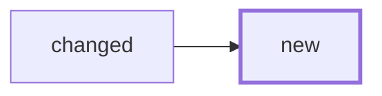

# PR body template

Target: readable in 1.5-2 minutes. Prose budget ≈350 words; images and the
diagram are free. Order = reading priority. Drop a section only when it does
not apply, and never leave an empty heading.

```markdown
## Summary
<1-2 sentences: what this does and why. Source: spec digest.>

## Before / after            <!-- UI changes only; most important section -->
| Screen / state | Before | After |
|---|---|---|
| <capture name> | " width="260"> | " width="260"> |
<!-- new screen: Before = "new". 4 rows max; pick the changed states that
     matter, link the rest from the assets branch. -->

## Changes
- <major change, behavior level, one line>
- <≤5 bullets; name mechanical churn once: "renames in 8 files, no logic">

## Check these (top 3)
1. [`<File.kt L40-L72>`](<PR diff link: pull/N/files#diff-H R40-R72>) — <what to check> (<why it is risky>)
2. [`<path L10-L18>`](<PR diff link>) — <…>
3. [`<path L5>`](<PR diff link>) — <…>

## Diagram                   <!-- only when structure/flow changed -->


<!-- Add ONE line, only if true: -->
Not verified: <what did not run and why — e.g. no device run; goldfish lens
reuse not run>.
```

Rules:

- Every statement traces to an artifact (spec, ticket Resolution, review
  report, ledger, capture file). Copy, do not recollect.
- "Check these" are the places a reviewer could plausibly get it wrong, in
  priority order — not a tour of the diff. Fewer than three is fine.
- The "Not verified" line is mandatory when review or evidence skipped
  anything notable (no capture, no smoke test, unrun lens, `cannot-verify`);
  omit it only when nothing was skipped. It is one line, not a section.
- Stacked run: the bottom PR uses this template; every layer above uses the
  short per-layer shape in [stacks.md](stacks.md) and links into its own
  PR's diff.
