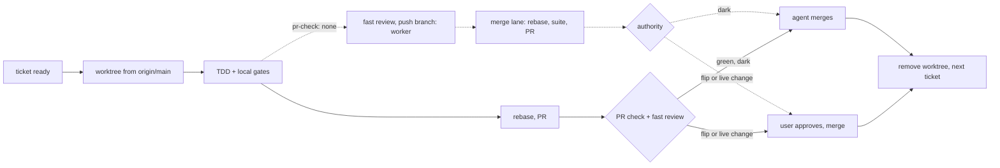

> **TL;DR** One ticket = one small PR off fresh `main`, merged in hours; unfinished behavior merges dark behind a release flag; the feature ships by a flip PR after user-check. Owns slice size, merge authority, unflaggable changes and the flag lifecycle on the git side.
> **Related**: skill://start (asks/plans delivery mode), skill://write-tickets (cuts mergeable-dark tickets), skill://implement (one worktree + PR per ticket), skill://open-pr (slice and flip PR bodies, merge commands), skill://wire-dev-settings (owns flag code: release flags, overrides), skill://user-check (tries the feature from main, flag forced on), skill://review-change (fast tier per slice, thorough before the flip), skill://deliver (ships the flip), skill://micro-architecture (branch by abstraction, expand/contract), skill://init-profile (`changes: trunk`, consent line)

# Ship to trunk

Big run branches and stacks rot: main moves, the merge conflicts grow with
every day of the run, and a 2,000-line PR gets merged unread. Trunk-based
development keeps the distance to main small instead: branches live for
hours, PRs are small enough to read in minutes, and **merge is separated from
release** by flags. Main is always releasable; whether it releases is a
decision, not a side effect.

Opt-in per project: the user picks `default` or `trunk` in `init-profile`
(development style), recorded as PROFILE `changes:`. This skill applies
only to `changes: trunk` runs (or a run where the user answered trunk to
start's `ask`); never switch a project to trunk on your own.

## Invariants (MUST)

1. **Main is releasable after every merge**: it builds, the PR check passes
   (`pr-check: none`: the local suite on the rebased head), and no
   unfinished user-visible behavior is reachable in a release build.
2. **One ticket = one PR**, one concern, ≤ ~400 changed lines (generated
   files, goldens and lockfiles excluded). Bigger → split the ticket before
   coding, never after.
3. **Branch lifetime is hours.** A branch older than a working day is a
   finding: merge it, split it, or drop it.
4. **Fresh base**: each ticket starts in its own worktree from
   `origin/main` fetched at dispatch, and rebases onto `origin/main` right
   before the PR and again before merge (`pr-check: none`: one rebase,
   right before the suite, run by the orchestrator's merge lane after the
   worker's fast review; the PR opens after the suite and merges at once).
   Never branch off another unmerged ticket by default.
5. **Dark until flipped**: a ticket whose behavior is not finished lands
   behind a **release flag** that is off in release builds
   (`wire-dev-settings` owns the code). Refactors, tests, additive unused
   APIs and pure plumbing need no flag.
6. **Slices never release**: no slice bumps the release version or changes
   the release default of a flag. The release is the **flip PR**.
7. **Unflaggable changes ship live** and backward compatible, with the
   user's approval: Room/SQL migrations, persisted formats (DataStore,
   files, Firestore documents), manifest and permissions, dependency and SDK
   bumps. Rules: [references/slicing.md](references/slicing.md).

## The loop

Commands, conflicts and the no-CI fallback:
[references/merge-loop.md](references/merge-loop.md).

## Merge authority

| PR kind | Who merges |
|---|---|
| Slice, dark or non-behavioral, check green (`pr-check: none`: local suite green on the rebased branch) + fast review clean | agent, when the consent ledger has `merge dark slices on green` |
| Bug fix (live by nature) | agent on green, same as PROFILE's fix rules; patch bump per project policy |
| Unflaggable live change (invariant 7) | user approves the PR |
| Flip PR (release) | user approves, after user-check OK and thorough review |

No consent line → every PR waits for the user; say so once in the run plan,
never infer consent from silence. The orchestrator announces a PR waiting
for the user through the ask tool (PR link, what changed, why it is theirs;
approve never preselected — `start` § Waiting on the user). With
`pr-check: none`, main's post-merge workflow is the safety net: workers
never wait on it, and never merge: they push the branch, report ready and
stop; the orchestrator's merge lane lands one ticket at a time
(`scripts/merge_lane.py`). The orchestrator's background watcher records
its verdict in a shared main-health ledger, and a red main stops all
merges but the fix (Red main below).

## Feature lifecycle

1. **Flag ticket first** (ticket 01): adds the release flag, off in release,
   forced-on toggle in debug. Merges in minutes; every later ticket gates
   behind it.
2. **Slices**: tickets merge in dependency order; a dependent ticket is
   dispatched only after its parent's PR merged (the frontier is "parents
   merged", not "parents done").
3. **User-check**: debug build from `main` with the flag forced on, after
   the last feature slice merged. Fast fixes and hardening tickets are new
   slices.
4. **Thorough review** over the feature's merged range
   (`git diff <base>..origin/main` scoped to the feature's PRs) — before the
   flip, never per slice.
5. **Flip PR**: release default on + version bump + changelog. This is the
   release; `deliver` ships it.
6. **Cleanup ticket**: remove the flag and the dead branch once the flip is
   released; written at ticket time, scheduled right after the flip. Stale
   flags are debt (`ponytail-debt` lists them).

## Decision rules

- **Stacks are the exception**: only when a dependent ticket must start
  while its parent PR waits on the user (live change, flip). Merge each
  layer as soon as it is green; never hold a stack for an atomic merge.
- **Parallel agents**: tickets that touch the same file never run at the
  same time; a shared registry/`when`/DI module edit is its own tiny
  ticket merged first (`micro-architecture`).
- **Conflict on rebase** > ~50 lines, or in a file another in-flight ticket
  owns → the slicing was wrong: stop, re-slice, report. Never resolve by
  dropping the other side.
- **Red main** (check fails after a merge): the next PR is the revert of
  the culprit, before any other merge. Fix forward only when the fix is
  one line and obvious. `pr-check: none`: `scripts/main_health.py` keeps
  the verdict, the claim (one owner, 30-min takeover) and held PRs;
  the lane calls its `status` before merging and holds on red
  ([references/merge-loop.md](references/merge-loop.md) § Red main).
- **No required PR check → no trunk.** Trunk mode needs CI as the judge:
  a workflow on `pull_request` that main's branch protection requires.
  Missing → the run's first ticket is the check setup (one ordinary PR,
  user-approved); slices start only after it merged and the user turned on
  protection. Local gates never stand in for it, unless PROFILE says
  `pr-check: none` — an opt-in project ruling: CI runs on main only and the
  merge gate is the local suite on the branch rebased onto fresh
  `origin/main` ([references/merge-loop.md](references/merge-loop.md)).

## Ledger

One line per event in `.scratch/<slug>/ledger.md`:
`slice: <NN> PR #<n> merged @ <sha>` ·
`flag: <Key> added | flipped | removed (PR #<n>)` ·
`live: <NN> <what> approved by user` ·
`held: <NN> PR #<n> (main red)` ·
`main: red @ <sha7> culprit <sha7|#PR> → fix PR #<n>`.

Footer: authored for ivanDsky/skills. Cited only: Ian Johnson, "Trunk-Based
Development with Short-Lived Branches" (dev.to/tacoda) and Igor Grieder,
"Agentic Git Workflow" (dev.to/igor_grieder) — short-lived branches, merge
≠ release, flags, worktree per task. No text copied.
