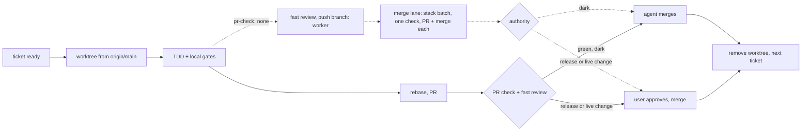

> **TL;DR** One ticket = one small PR off fresh `main`, merged in hours; unfinished behavior merges dark behind a release flag; the feature ships by one release PR (flags on and removed, version bumped) after user-check, on one explicit owner Yes to "Release <X.Y.Z>?". Owns slice size, merge authority, unflaggable changes and the flag lifecycle on the git side.
> **Related**: skill://start (asks/plans delivery mode), skill://write-tickets (cuts mergeable-dark tickets), skill://implement (one worktree + PR per ticket), skill://open-pr (slice and release PR bodies, merge commands), skill://wire-dev-settings (owns flag code: release flags, overrides), skill://user-check (tries the feature from main, flag forced on), skill://review-change (fast tier per slice, thorough before the release), skill://deliver (ships the release), skill://micro-architecture (branch by abstraction, expand/contract), skill://init-profile (`changes: trunk`, consent line)

# Ship to trunk

Big run branches and stacks rot: main moves, the merge conflicts grow with
every day of the run, and a 2,000-line PR gets merged unread. Trunk-based
development keeps the distance to main small instead: branches live for
hours, PRs are small enough to read in minutes, and **merge is separated from
release** by flags. Main is always releasable; whether it releases is a
decision, not a side effect.

Opt-in per project: the user picks `default` or `trunk` in `init-profile`
(development style), recorded as PROFILE `changes:`. This skill applies
only to `changes: trunk` runs (or a run where the user answered trunk to
start's `ask`); never switch a project to trunk on your own.

## Invariants (MUST)

1. **Main is releasable after every merge**: it builds, the PR check passes
   (`pr-check: none`: the lane's local check on the rebased head), and no
   unfinished user-visible behavior is reachable in a release build.
2. **One ticket = one PR**, one concern, ≤ ~400 changed lines (generated
   files, goldens and lockfiles excluded). Bigger → split the ticket before
   coding, never after.
3. **Branch lifetime is hours.** A branch older than a working day is a
   finding: merge it, split it, or drop it.
4. **Fresh base**: each ticket starts in its own worktree from
   `origin/main` fetched at dispatch, and rebases onto `origin/main` right
   before the PR and again before merge (`pr-check: none`: one rebase,
   right before the check, run by the repository's one merge lane after the
   worker's fast review; every session enqueues into that lane, which
   stacks up to 5 ready tickets per batch, runs one check on each batch top
   (PROFILE's `affected-check:` when set: only the tests the batch can
   break; else, or for a `--full`/`--red-fix` ticket, the suite; plus
   PROFILE's `e2e:` tier when the batch touches one of its `when:`
   modules or the shared build setup; two batches at once, the second
   stacked on the first) and opens and merges each PR in order).
   Never branch off another unmerged ticket by default.
5. **Dark until released**: a ticket whose behavior is not finished lands
   behind a **release flag** that is off in release builds
   (`wire-dev-settings` owns the code). Refactors, tests, additive unused
   APIs and pure plumbing need no flag.
6. **Slices never release**: no slice bumps the release version or changes
   the release default of a flag. The release is the **release PR**.
7. **Unflaggable changes ship live** and backward compatible, with the
   user's approval: Room/SQL migrations, persisted formats (DataStore,
   files, Firestore documents), manifest and permissions, dependency and SDK
   bumps. Rules: [references/slicing.md](references/slicing.md).

## The loop

Commands, conflicts and the no-CI fallback:
[references/merge-loop.md](references/merge-loop.md).

## Merge authority

| PR kind | Who merges |
|---|---|
| Slice, dark or non-behavioral, check green (`pr-check: none`: local lane check green on the rebased branch, or on a batch top it is part of) + fast review clean | agent, when the consent ledger has `merge dark slices on green` |
| Bug fix (live by nature) | agent on green, same as PROFILE's fix rules; patch bump per project policy |
| Unflaggable live change (invariant 7) | user approves the PR |
| Release PR (flags on and removed + bump) | user approves: an explicit Yes to "Release <X.Y.Z>?" asked once the PR is open and green, after thorough review |

No consent line → every PR waits for the user; say so once in the run plan,
never infer consent from silence. PRs waiting for the user share one ask (PR
links, what changed, why each is theirs) and agent merges are ledgered —
`start` § Waiting on the user. With
`pr-check: none`, main's post-merge workflow is the safety net: workers
never wait on it, and never merge: they push the branch, report ready and
stop; the repository's one merge lane, shared by every session, lands
ready tickets in batches of up to 5, two batches pipelined across the
build slots (`scripts/merge_lane.py`). The lane starts a background
watcher after a merge; `status` also records finished main runs from `gh`
before it answers. The verdict lives in a shared main-health ledger, and a
red main stops all merges but the fix (Red main below).

## Feature lifecycle

1. **Flag ticket first** (ticket 01): adds the release flag, off in release,
   forced-on toggle in debug. Merges in minutes; every later ticket gates
   behind it.
2. **Slices**: tickets merge in dependency order; a dependent ticket is
   dispatched only after its parent's PR merged (the frontier is "parents
   merged", not "parents done").
3. **User-check**: debug build from `main` with the flag forced on, after
   the last feature slice merged. Fast fixes and hardening tickets are new
   slices.
4. **Thorough review** over the feature's merged range
   (`git diff <base>..origin/main` scoped to the feature's PRs) — before the
   release, never per slice.
5. **Release PR**, one per epic, written up front as the last ticket
   (`Release <X.Y.Z>: turn on and remove <Epic> flags`); epics checked in
   the same round may share one. The hands-on check ("does it feel right?")
   is its own earlier ask on the check APK and carries no release ask. Then
   one PR off fresh `origin/main`: one commit per flag (flag, its off
   branch, debug override and the old code path it hid; on is the only
   behavior), the same for every other shipped-on flag still in code, and a
   last commit with the version bump (PROFILE `version:`, the Gradle
   versionName fallback, top entry of `docs/release-history.md`). One gate suite, plus the thorough review
   already required before it. It is enqueued with `--no-merge --full`
   (the full suite, never the affected check): after the
   green suite the PR is open and unmerged. The builder asks nothing; the
   merging orchestrator asks "Release <X.Y.Z>?" through the ask tool, with
   the release-history entry in the question (features turned on, fixes
   since the last release, flags removed). Options `Yes, release
   (Recommended)` / `No`; only an explicit Yes to that question merges,
   never silence, "looks good" on the check or a reply to another
   question. No, or no answer, leaves it enqueued `--no-merge`. Record the
   answer on the release ticket. No ask tool in the merger's session → the
   same question goes in an `OWNER:` line, relayed verbatim. On Yes it
   merges as a `waiting_user` PR (`references/merge-loop.md`; ledger
   `release: <X.Y.Z> approved by user <date> (PR #<n>)`). A red suite drops
   the failing flag's removal commit for a one-line release-default-on flip:
   that flag ships on and its removal goes to step 6; the release never
   waits on a removal fix. It is one flag-touching PR in the lane and
   `deliver` ships `main` at that merge sha. Destructive migrations and manifest, permission or SDK
   changes stay out of it (own tickets, own asks). Rollback is a revert of
   the release PR, a new release like any merge.
6. **Leftover removal, batched**: only for flags the release PR did not
   remove: dropped by a red suite, or flipped outside a release PR. One
   open "Remove the shipped-on flags" ticket at a time removes them on
   fresh `origin/main`: one PR, one commit per flag, one check, no fixes
   inside it (under `pr-check: none`, the fix worker handles the lane's
   `red` result). The next release PR folds any open one in, and its ticket
   closes with a pointer. Stale flags are debt (`ponytail-debt` lists
   them).

## Decision rules

- **Stacks are the exception**: only when a dependent ticket must start
  while its parent PR waits on the user (live change, release). Merge each
  layer as soon as it is green; never hold a stack for an atomic merge.
- **Parallel agents**: tickets that touch the same file never run at the
  same time; a shared registry/`when`/DI module edit is its own tiny
  ticket merged first (`micro-architecture`).
- **Independent series enqueue together**: slices that need none of each
  other merged first (mechanical moves of different packages) are built
  in parallel or back to back and enqueued at once, so one lane batch
  tests them with one check. A move or refactor series also holds feature
  tickets in its module until it lands (`work-tickets` claim skips them).
- **Conflict on rebase** > ~50 lines, or in a file another in-flight ticket
  owns → the slicing was wrong: stop, re-slice, report. Never resolve by
  dropping the other side.
- **Red main** (check fails after a merge): the next PR is the revert of
  the culprit, before any other merge. Fix forward only when the fix is
  one line and obvious. `pr-check: none`: `scripts/main_health.py` keeps
  the verdict, each red run's cause and failing tests, the claim (one
  owner, 30-min takeover) and PRs held outside the lane; the lane pauses on
  red and queued tickets wait. A test that fails on main and passes on
  rerun is quarantined in the same incident, for at most 48 h. A red no
  culprit explains (the affected check missed it, no commit pointer, the
  revert did not clear it, the same test red again) is unexpected and
  escalates: full suite on the red sha, `diagnose-bug` at full depth,
  `tdd` fix, widen the affected map, tell the user
  ([references/merge-loop.md](references/merge-loop.md) § Red main).
- **No required PR check → no trunk.** Trunk mode needs CI as the judge:
  a workflow on `pull_request` that main's branch protection requires.
  Missing → the run's first ticket is the check setup (one ordinary PR,
  user-approved); slices start only after it merged and the user turned on
  protection. Local gates never stand in for it, unless PROFILE says
  `pr-check: none` — an opt-in project ruling: CI runs on main only and the
  merge gate is the local lane check (affected or suite) on the branch
  rebased onto fresh `origin/main`; main's post-merge workflow runs the full
  suite ([references/merge-loop.md](references/merge-loop.md)).

## Ledger

One line per event in `.scratch/<slug>/ledger.md`:
`slice: <NN> PR #<n> merged @ <sha>` (the squash commit on main) ·
`flag: <Key> added | flipped | removed (PR #<n>)` ·
`release: <X.Y.Z> approved by user <date> (PR #<n>)` ·
`live: <NN> <what> approved by user` ·
`held: <NN> PR #<n> (main red)` ·
`main: red @ <sha7> culprit <sha7|#PR> → fix PR #<n>`.

Footer: authored for ivanDsky/skills. Cited only: Ian Johnson, "Trunk-Based
Development with Short-Lived Branches" (dev.to/tacoda) and Igor Grieder,
"Agentic Git Workflow" (dev.to/igor_grieder) — short-lived branches, merge
≠ release, flags, worktree per task. No text copied.
